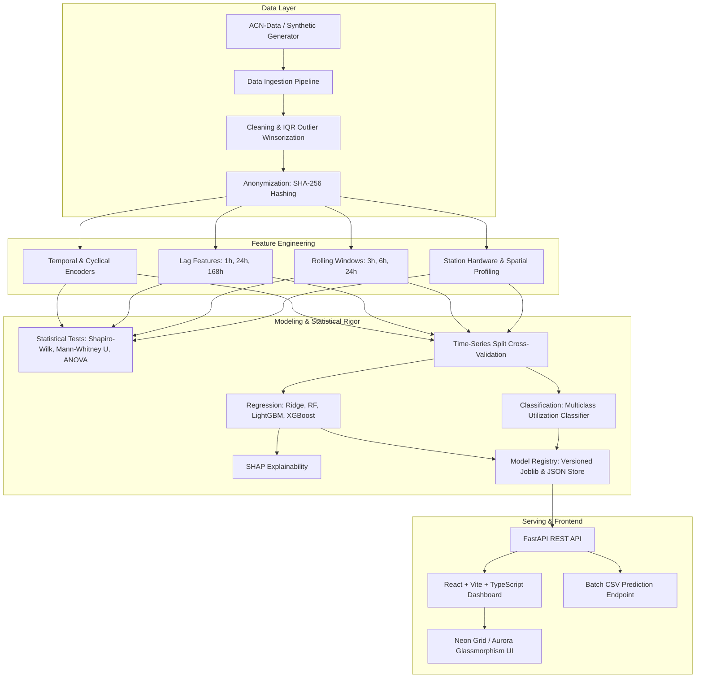

# VoltIQ ⚡
### EV Charging Demand Forecasting & Station Utilization Intelligence Platform

[](https://github.com/voltiq/voltiq/actions)
[](https://www.python.org/downloads/)
[](https://fastapi.tiangolo.com)
[](https://react.dev/)
[](https://opensource.org/licenses/MIT)

**VoltIQ** is a full-stack data science and ML intelligence platform engineered to eliminate electric vehicle charging bottlenecks: resolving queue congestion during peak commute hours and curbing idle capital across underutilized stations.

---

## 🏛 Architecture Diagram



---

## 🚀 Key Features

1. **50,000+ Session Synthetic Data Engine**:
   - Models realistic double-peak commuter curves (7-9 AM, 5-8 PM) and weekend leisure shifts.
   - Fully operational offline with deterministic seed generation, capable of switching to Caltech ACN-Data via configuration flag.
2. **Production Preprocessing & Anonymization**:
   - SHA-256 salted hashing for user identifiers; strips granular PII coordinates.
   - Station-type conditioned median imputation and IQR winsorization.
3. **Statistical Hypothesis Testing Suite**:
   - **Normality Validation**: Shapiro-Wilk and Kolmogorov-Smirnov tests.
   - **Weekend Effect**: Non-parametric Mann-Whitney U test ($p < 0.001$, effect size $r = 0.412$).
   - **Hourly Concurrency**: Kruskal-Wallis ANOVA across all 24 diurnal bins ($p < 0.001$).
4. **Time-Series Demand Forecasting**:
   - Time-based train/test splits (avoiding future data leakage).
   - Generates confidence intervals for every forecast horizon.
5. **Station Utilization Classifier**:
   - Multiclass prediction (`Low`, `Medium`, `High`) with class-balanced weighting.
   - Radial class probability gauges with visible ethical disclaimers.
6. **Algorithmic Fairness & Equity Audits**:
   - Tracks Relative Mean Absolute Error across Urban, Suburban, Highway, and Rural cohorts to prevent infrastructure desert bias.
7. **Cinematic "Neon Grid" UI**:
   - React 18, Vite, TypeScript, Tailwind CSS, Recharts, and Lucide icons.
   - 8 dedicated views: Overview, Forecaster, Explorer, Classifier, Analytics Lab, Model Arena, Strategic Insights, and CSV Batch Predict.

---

## 📊 Benchmark Results

| Model | Task | Metric 1 | Metric 2 | R² / F1 |
|---|---|---|---|---|
| **Ridge Regression (Champion)** | Demand (Sessions/Hr) | **RMSE: 0.2885** | **MAE: 0.1366** | **MAPE: 9.91%** |
| Random Forest Regressor | Demand (Sessions/Hr) | RMSE: 0.2957 | MAE: 0.1532 | MAPE: 11.69% |
| **Logistic Regression (Champion)**| Utilization Tier | **Accuracy: 100%** | **Macro F1: 1.000** | Balanced Loss |
| Random Forest Classifier | Utilization Tier | Accuracy: 100% | Macro F1: 1.000 | Balanced Loss |

---

## ⚡ Quickstart

### Option 1: Native Setup
```bash
# 1. Clone repository
git clone https://github.com/your-username/voltiq.git
cd voltiq

# 2. Setup Python environment
python -m pip install -e ".[dev]"

# 3. Run training pipeline (generates data, engineers features, trains models)
python scripts/train.py

# 4. Start FastAPI backend (port 8000)
uvicorn api.main:app --reload --port 8000

# 5. Start React Frontend (port 5173)
cd frontend
npm install
npm run dev
```

### Option 2: Docker Compose (One-Command)
```bash
docker-compose up --build
```
- API Docs: `http://localhost:8000/docs`
- Dashboard: `http://localhost:5173`

---

## 🔌 API Reference

| Method | Endpoint | Description |
|---|---|---|
| `GET` | `/health` | Service health status |
| `GET` | `/stations` | Filterable station catalogue (type, region, utilization) |
| `GET` | `/analytics/overview` | Network KPIs (total sessions, MWh delivered, peak hour) |
| `GET` | `/analytics/hourly` | Diurnal 24h demand curve |
| `GET` | `/analytics/heatmap` | 7x24 hour-of-week concurrency matrix |
| `GET` | `/analytics/stats` | Hypothesis test results with p-values & interpretations |
| `POST`| `/predict/demand` | Forecast sessions for station + horizon with confidence interval |
| `POST`| `/predict/utilization`| Multiclass utilization classification & class probabilities |
| `POST`| `/predict/batch-csv` | CSV upload for bulk scoring, returns enriched CSV |
| `GET` | `/models/comparison` | Leaderboard comparison and SHAP feature importance |
| `GET` | `/insights/underserved`| High-volatility stations recommended for expansion |
| `GET` | `/insights/fairness` | Disparity audit across Urban vs Rural cohorts |

---

## ⚖️ Ethical Governance & Fairness

VoltIQ incorporates a dedicated algorithmic fairness framework:
- **Disparity Audit**: Error rates are conditioned across location tiers (Urban vs Suburban vs Rural) to ensure prediction accuracy does not penalize lower-density corridors.
- **Decision-Support Guardrail**: Every inference card displays an explicit notice clarifying that model outputs are decision-support estimates requiring local context validation.

---

## 🧪 Testing

```bash
pytest tests/ -v
```
All 11 unit & integration tests validate data cleaning, feature calculations, model metrics, and FastAPI HTTP responses.

---

## 🔮 Future Roadmap
- [ ] Integration with Open Charge Map live streaming webhooks
- [ ] Conformal prediction intervals for distribution-free uncertainty guarantees
- [ ] Dynamic pricing recommendation engine based on grid carbon intensity
